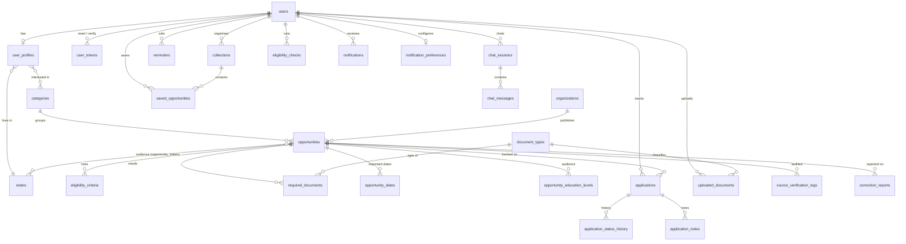

# FormSaathi — Database Design

Source of truth: `backend/app/models/` (SQLAlchemy 2.0) → migration `backend/migrations/versions/*_initial_schema.py`.
Target: **PostgreSQL 16**. The same models run on SQLite for quick local dev/tests.

## Entity-relationship overview

## Tables (31)

| Domain | Table | Purpose | Key constraints |
|--------|-------|---------|-----------------|
| Identity | `users` | Login identity + role (`user`/`admin`) | `email` unique, CHECK lowercase; lockout fields |
| | `user_profiles` | 1:1 personalisation data | PK = `user_id`; CHECK marks range by type (≤100 % / ≤10 CGPA); year 1–10; sensitive fields nullable |
| | `profile_interest_categories` | M:N profile ↔ categories | composite PK |
| | `user_tokens` | Password reset / email verify | stores **SHA-256 hash** only; unique |
| | `revoked_tokens` | JWT logout blocklist | PK `jti`, index `expires_at` for purging |
| | `states` | 28 states + 8 UTs | PK slug code |
| Catalogue | `categories` | Scholarships, internships, … | `slug`, `name` unique |
| | `organizations` | Source organisation | `name` unique |
| | `opportunities` | The official record | `slug` unique; `source_url` NOT NULL; CHECK `verified ⇒ last_verified_at`; CHECK `demo ⇒ never verified`; CHECK `deadline ≥ opens_on`; CHECK benefit max ≥ min; composite listing index |
| | `eligibility_criteria` | Machine-checkable rules + quoted `source_excerpt` | FK cascade |
| | `opportunity_states`, `opportunity_education_levels` | Audience tags for fast filters | composite PK, indexed |
| | `document_types` | Aadhaar, income cert, … with `sensitivity` | `slug` unique |
| | `required_documents` | Docs needed per opportunity | UNIQUE (opportunity, type) |
| | `opportunity_dates` | Exam/result/other dates | FK cascade |
| Engagement | `collections` | Bookmark folders | UNIQUE (user, name) |
| | `saved_opportunities` | Bookmarks | UNIQUE (user, opportunity) |
| | `applications` | Tracker card | UNIQUE (user, opportunity); `status_source` (`user`/`integration`/`system`) |
| | `application_status_history` | Timeline | append-only |
| | `application_notes` | User notes | |
| | `reminders` | Personal reminders | index (`sent_at`, `remind_at`) for the worker |
| Documents | `uploaded_documents` | Private vault metadata | `stored_filename` unique (random); CHECK size > 0; `sha256`; soft delete |
| AI | `chat_sessions` / `chat_messages` | Saathi AI history | UUID session id; token usage per message |
| | `eligibility_checks` | Rule-engine verdict + optional AI explanation | `profile_hash` + `criteria_hash` for cache invalidation |
| Notify | `notifications` | In-app inbox | UNIQUE (user, `dedupe_key`) prevents duplicate reminders |
| | `notification_preferences` | Per-user switches | CHECK days-before 1–60 |
| Admin | `source_verification_logs` | Audit trail of every verification/status change | append-only |
| | `correction_reports` | User-reported errors | status workflow |
| | `announcements` | Site banners | CHECK window order |
| | `feedback` | In-app feedback + contact form | |

## Design decisions

1. **Enums as VARCHAR + CHECK**, not native PG enums — adding a status is a simple migration, and SQLite works too. Values live in one place: `app/models/base.py`.
2. **Integrity rules in the database, not just the app.** "Demo data can never be verified" and "verified requires a verification date" are CHECK constraints, so no buggy endpoint can break the trust model.
3. **One `users` table with a `role`**, instead of a separate `AdminUsers` table: no duplicate identities or passwords. Admin actions are attributed via `verified_by_id`, `actor_id`, `reviewed_by_id`.
4. **Structured eligibility** (`criterion_type` + JSON `value`) lets a deterministic engine compute results; `custom` criteria are always shown as "needs your review".
5. **Audience tag tables** (`opportunity_states`, `opportunity_education_levels`) duplicate a small part of the criteria for fast, indexable filtering. The admin editor writes both in one transaction (Phase 7).
6. **Income stored as a band**, not an exact figure — enough to match against cut-offs, less sensitive to store.
7. **Timestamps** are timezone-aware (`timestamptz`) with server defaults.
8. **Deterministic constraint names** (naming convention) so migrations are readable and reversible.
9. **ON DELETE** chosen deliberately: user data `CASCADE` (account deletion wipes personal data), catalogue references `RESTRICT` (can't delete a category still in use), audit/actor references `SET NULL` (history survives a deleted admin).

## Planned PostgreSQL-only additions (Phase 4/8 migrations)
- `CREATE EXTENSION pg_trgm;` + GIN trigram index on `opportunities.title` for fuzzy search.
- Partial index `WHERE publication_status = 'published'` on the listing index.
